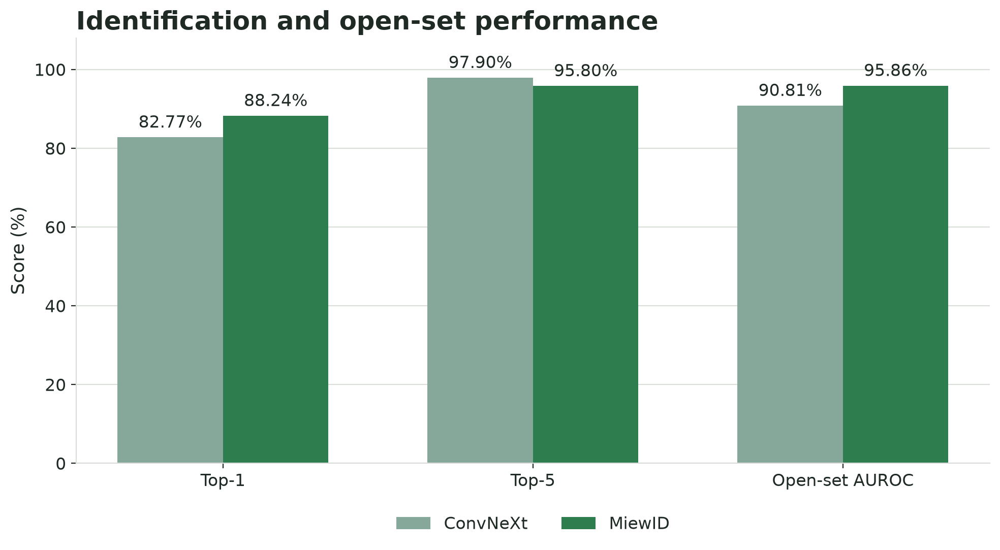
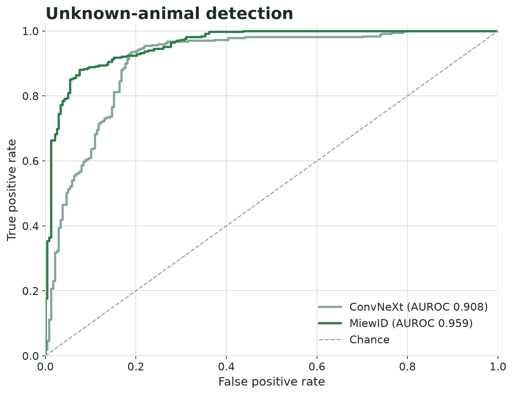
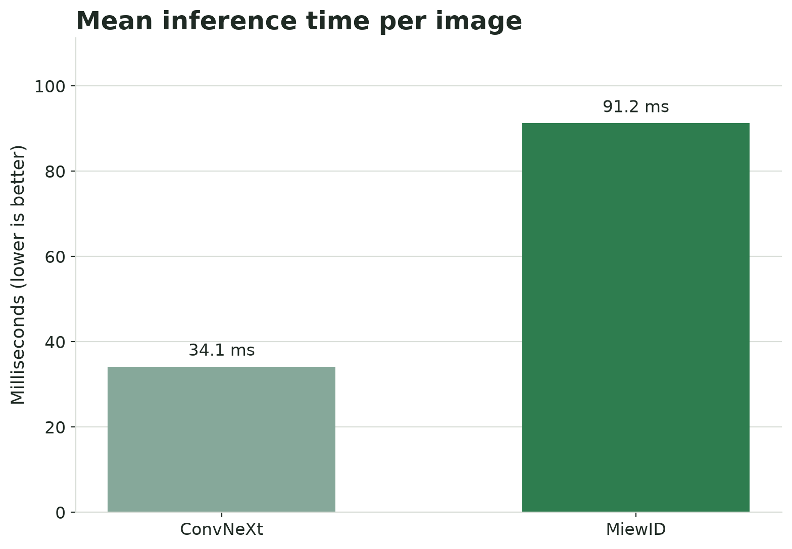

# WildlifeReID-10k Model Comparison

## Final results

This experiment compares the existing ConvNeXt Base and MiewID checkpoints without retraining either model. Both checkpoints use the same ordered list of 100 known WildlifeReID-10k identities. The evaluator applies both models to the same 606 test queries: 238 new images of known identities and 368 images from 20 identities that do not occur in the training split.

## Evaluation protocol

- Dataset: WildlifeReID-10k version 10 metadata and official train/test labels.
- Known set: the same 100 training identities selected with `random_state=42`.
- Known queries: test-split images belonging to the selected identities.
- Unknown queries: test-split images from 20 identities absent from the complete training split.
- Top-1 and Top-5: calculated only on the 238 known queries.
- Open-set AUROC: calculated across all 606 queries using `1 - maximum score` as the unknown score.
- Timing: mean per-image inference time on the same Apple Metal device, excluding model loading and image download time.

ConvNeXt produces class probabilities with a softmax classifier. MiewID generates an embedding and retrieves the closest known identity from its stored gallery using cosine similarity. The raw scores have different meanings, so a shared fixed confidence threshold would not be a fair comparison. AUROC avoids that problem because it measures score ranking across all possible thresholds.

## Results

| Model | Method | Top-1 | Top-5 | Open-set AUROC | Mean inference |
|---|---|---:|---:|---:|---:|
| ConvNeXt Base | Classification with softmax | 82.77% | **97.90%** | 90.81% | **34.1 ms** |
| MiewID | Embedding and cosine retrieval | **88.24%** | 95.80% | **95.86%** | 91.2 ms |







## Interpretation

MiewID provides the stronger overall re-identification result. It improves Top-1 accuracy by 5.47 percentage points and open-set AUROC by 5.05 percentage points. These measures matter most when the system must return one animal identity while also separating unseen animals from known individuals.

ConvNeXt remains useful as a fast baseline. It processes an image in 34.1 ms on average, compared with 91.2 ms for MiewID, and achieves a 2.10 percentage point advantage in Top-5 accuracy. Its stronger Top-5 result shows that the correct identity usually appears among its leading candidates even when its first choice is incorrect.

## Deployment decision

MiewID is the recommended model for the WildlifeReID application because it has the best Top-1 and open-set AUROC results. ConvNeXt should remain available in the interface as a comparison model and as the faster option.

The web application currently applies a configurable threshold for the user-facing `UNKNOWN` decision. That operating threshold should not be presented as a directly comparable confidence percentage across the two models because softmax probability and cosine similarity have different scales.

## Reproducibility

Run the complete comparison without retraining:

```bash
python src/models/evaluate_comparison.py --device auto
```

The command verifies the shared 100-identity list, evaluates both saved checkpoints on identical queries, and writes:

- `src/models/comparison_results.json` for the aggregate metrics.
- `src/models/comparison_predictions.csv` for every model-query prediction.

Regenerate the report figures with:

```bash
python docs/generate_results_assets.py
```

## Limitations

- The experiment compares complete model pipelines rather than identical architectures: ConvNeXt uses classification and MiewID uses embedding retrieval.
- The results cover a reproducible 100-identity subset rather than every WildlifeReID-10k identity.
- The deployment threshold has not been calibrated separately for each model, so the report uses threshold-independent AUROC for the open-set comparison.
- Inference timing reflects the evaluation machine and may differ on a production server or CUDA GPU.
